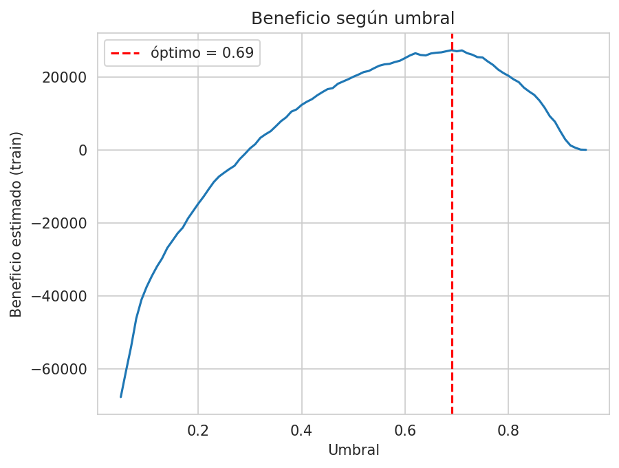

# Predicción de abandono y segmentación de clientes (Telco Customer Churn)

**Asignatura:** Machine Learning (MLY1101) · **Evaluación Parcial N°2**
**Integrantes:** Kimberly Bobadilla, Luna Cortés y Millaray Paillafil
**Caso seleccionado:** Caso A, Predicción de abandono de clientes (Telco Customer Churn)

---

## Índice

1. [Descripción del problema de negocio](#1-descripción-del-problema-de-negocio)
2. [Objetivos del proyecto](#2-objetivos-del-proyecto)
3. [Descripción de las fuentes de datos](#3-descripción-de-las-fuentes-de-datos)
4. [Metodología](#4-metodología)
5. [Análisis exploratorio de los datos (EDA)](#5-análisis-exploratorio-de-los-datos-eda)
6. [Preparación y transformación de los datos](#6-preparación-y-transformación-de-los-datos)
7. [Justificación de la selección de modelos](#7-justificación-de-la-selección-de-modelos)
8. [Variables finales incluidas por modelo](#8-variables-finales-incluidas-por-modelo)
9. [Implementación de los modelos supervisados](#9-implementación-de-los-modelos-supervisados)
10. [Evaluación y selección del modelo](#10-evaluación-y-selección-del-modelo)
11. [Revisión ética](#11-revisión-ética)
12. [Aprendizaje no supervisado: segmentación de clientes](#12-aprendizaje-no-supervisado-segmentación-de-clientes)
13. [Recomendaciones para el negocio](#13-recomendaciones-para-el-negocio)
14. [Limitaciones y trabajo futuro](#14-limitaciones-y-trabajo-futuro)
15. [Conclusiones](#15-conclusiones)

---

## Resumen

En este proyecto trabajamos con el dataset *Telco Customer Churn* de IBM (7.043 clientes) para predecir qué clientes tienen más probabilidad de abandonar una empresa de telecomunicaciones y para agruparlos en segmentos con características similares. Comparamos tres modelos supervisados de clasificación (Regresión Logística, Random Forest y Gradient Boosting) y aplicamos K-Means y clustering jerárquico como modelos no supervisados.

Los tres modelos supervisados dieron resultados muy parecidos (ROC-AUC en validación cruzada entre 0,845 y 0,848). Elegimos **Gradient Boosting balanceado** por tener el mejor ROC-AUC y Average Precision en validación cruzada, y analizamos distintos umbrales de decisión usando únicamente datos de entrenamiento, para estudiar el equilibrio entre Precision y Recall. En el conjunto de prueba, el umbral 0,69 ofrece mayor Precision que 0,50, aunque reduce el Recall. En el conjunto de prueba obtuvo ROC-AUC de 0,845, Precision de 0,651 y Recall de 0,588 con ese umbral. La segmentación con K-Means (k = 4) permitió identificar cuatro perfiles de clientes, con tasas de churn entre 7,4 % y 47,3 %.

---

## 1. Descripción del problema de negocio

Una empresa de telecomunicaciones pierde ingresos cada vez que un cliente se va (*churn*). Además, retener a un cliente cuesta menos que conseguir uno nuevo, por lo que le conviene saber con anticipación quiénes tienen más riesgo de irse para enfocar ahí sus ofertas de retención.

El problema se plantea como una **clasificación binaria**: `0` es un cliente que se queda y `1` es un cliente que abandona. El modelo no busca reemplazar la decisión de una persona, sino ayudar a priorizar a qué clientes contactar y cómo usar mejor el presupuesto de retención.

Como complemento, hicimos una **segmentación** de la cartera. La idea es que la empresa no aplique la misma estrategia a todos los clientes, sino que ajuste las acciones según el perfil y el nivel de riesgo de cada grupo.

## 2. Objetivos del proyecto

### 2.1 Objetivo general

Desarrollar y evaluar modelos de Machine Learning que permitan identificar clientes con riesgo de abandono y segmentarlos según sus características, para apoyar decisiones de retención.

### 2.2 Objetivos específicos

1. Analizar qué características tienen los clientes que abandonan (EDA).
2. Revisar la calidad de los datos: nulos y duplicados.
3. Preparar las variables para el entrenamiento de los modelos.
4. Construir y comparar tres modelos supervisados de clasificación: Regresión Logística, Random Forest y Gradient Boosting.
5. Ajustar los hiperparámetros con validación cruzada y `GridSearchCV`.
6. Evaluar los modelos con métricas adecuadas a un problema desbalanceado (Precision, Recall, F1, ROC-AUC y Average Precision) y estudiar el efecto del umbral de decisión en el equilibrio entre Precision y Recall.
7. Agrupar a los clientes con modelos no supervisados (K-Means y clustering jerárquico).
8. Revisar el impacto ético del modelo, en particular posibles diferencias de error entre grupos.
9. Proponer recomendaciones de negocio a partir de los resultados.

## 3. Descripción de las fuentes de datos

Usamos el dataset **Telco Customer Churn (IBM)**. La versión con la que trabajamos es una versión limpia guardada en `data/Telco_Customer_Churn_Clean.csv`, que tiene **7.043 clientes y 20 variables**. No incluye el identificador `customerID`.

| Grupo | Variables |
|---|---|
| Demográficas | `gender`, `SeniorCitizen`, `Partner`, `Dependents` |
| Servicios contratados | `PhoneService`, `MultipleLines`, `InternetService`, `OnlineSecurity`, `OnlineBackup`, `DeviceProtection`, `TechSupport`, `StreamingTV`, `StreamingMovies` |
| Contrato y pago | `Contract`, `PaperlessBilling`, `PaymentMethod` |
| Numéricas | `tenure` (meses de antigüedad), `MonthlyCharges`, `TotalCharges` |
| Variable objetivo | `Churn` (Yes/No) |

## 4. Metodología

Seguimos una versión adaptada de **CRISP-DM**: comprensión del negocio, comprensión de los datos, preparación, modelado, evaluación y recomendaciones. A esas etapas les agregamos una de segmentación no supervisada y una revisión ética.

Trabajamos en Python con Google Colab y las librerías pandas, NumPy, Matplotlib, Seaborn y scikit-learn. Para que los resultados se puedan reproducir fijamos `random_state = 42` en todo el proyecto.

---

## 5. Análisis exploratorio de los datos (EDA)

### 5.1 Calidad de los datos

Revisamos el tamaño del dataset, los tipos de dato, los valores nulos, los duplicados y los estadísticos de las variables numéricas.

- **Nulos:** en la versión limpia, `TotalCharges` ya está en formato numérico y los valores faltantes se trataron antes del modelamiento.
- **Duplicados:** hay **22 filas repetidas (0,3 %)**. Como el dataset lo limpiamos nosotras en la evaluación anterior podemos asegurar que apesar de no contar con  `CustomerID` son clientes distintos.
- **`TotalCharges = 0`:** corresponde a **11 clientes con `tenure = 0`** (clientes nuevos que todavía no reciben su primera factura). Son registros válidos, por lo que se mantuvieron.

### 5.2 Variable objetivo

| Churn | Cantidad | Porcentaje |
|---|---|---|
| No | 5.174 | 73,5 % |
| Sí | 1.869 | 26,5 % |

Las clases están desbalanceadas (26,5 % de abandono). Esto significa que la *accuracy* por sí sola no sirve para evaluar, porque un modelo que dijera siempre "no se va" acertaría cerca del 73 % sin detectar a nadie. Por eso usamos también Precision, Recall, F1, ROC-AUC y Average Precision, y balanceamos las clases al entrenar.

### 5.3 Variables numéricas

| Variable (promedio) | Se quedan | Se van |
|---|---|---|
| `tenure` (meses) | 37,6 | 18,0 |
| `MonthlyCharges` | 61,3 | 74,4 |
| `TotalCharges` | 2.550 | 1.532 |

Los clientes que se van tienen la mitad de antigüedad y pagan más al mes. El `TotalCharges` más bajo no es un hallazgo por sí mismo, ya que sale simplemente de que llevan menos tiempo como clientes. Los clientes antiguos casi no se van.

### 5.4 Variables categóricas

| Variable | Tasa de churn observada |
|---|---|
| Contrato | Mes a mes: 42,7 % · 1 año: 11,3 % · 2 años: 2,8 % |
| Internet | Fibra óptica: 41,9 % · DSL: 19,0 % · Sin internet: 7,4 % |
| Método de pago | Cheque electrónico: 45,3 % · otros métodos: entre 15,2 % y 19,1 % |
| Soporte técnico | Sin soporte: 41,6 % · Con soporte: 15,2 % |
| Adulto mayor (`SeniorCitizen`) | Adultos mayores: 41,7 % · resto: 23,6 % |
| Género | Mujeres: 26,9 % · Hombres: 26,2 % (sin diferencia relevante) |

El riesgo se concentra en clientes con contrato mes a mes, fibra óptica, pago con cheque electrónico y sin soporte técnico. Son asociaciones que aparecen en los datos, pero no demuestran que esas características *causen* el abandono.

### 5.5 Correlaciones

- `tenure` tiene una correlación negativa moderada con el churn (**−0,35**): mientras más nuevo el cliente, más probable que se vaya.
- `MonthlyCharges` tiene una relación positiva leve con el churn (**0,19**).
- `TotalCharges` y `tenure` están muy correlacionadas (**0,83**). Esta multicolinealidad nos llevó a excluir `TotalCharges` de la Regresión Logística (ver secciones 6 y 8).

---

## 6. Preparación y transformación de los datos

1. **Variable objetivo:** `Churn` se transformó a binaria (`No` = 0, `Yes` = 1).
2. **Exclusión de `gender`:** se sacó de las variables predictoras por criterio ético. Se conservó solo para auditar el modelo después (sección 11).
3. **Codificación:** las variables categóricas se transformaron con *One-Hot Encoding* (`pd.get_dummies` con `drop_first=True`). Quedaron **29 variables predictoras** en total.
4. **División train/test:** 80 % para entrenamiento (5.634 clientes) y 20 % para prueba (1.409 clientes), con `random_state = 42` y `stratify = y`, de modo que ambos conjuntos mantengan la misma proporción de churn (26,5 %).
5. **Escalado:** solo se aplicó `StandardScaler` a la Regresión Logística (dentro de un *pipeline*, para que el escalador se ajuste únicamente con los datos de entrenamiento de cada fold). Los modelos basados en árboles no lo necesitan.
6. **Desbalance de clases:** se trató con `class_weight='balanced'` en Regresión Logística y Random Forest, y con pesos de muestra balanceados (`sample_weight`) en Gradient Boosting, ya que este modelo no tiene el parámetro `class_weight`.
7. **Validación:** los tres modelos usan los mismos **5 folds estratificados** (`StratifiedKFold`, con `shuffle=True`).

---

## 7. Justificación de la selección de modelos

Elegimos tres modelos que representan enfoques distintos, para poder comparar un modelo lineal contra modelos basados en árboles.

| Modelo | Por qué lo elegimos |
|---|---|
| **Regresión Logística** | Es la línea base. Es simple, interpretable y sus coeficientes permiten ver la dirección en que cada variable afecta el riesgo de churn. |
| **Random Forest** | Captura relaciones no lineales e interacciones entre variables sin necesitar escalado, y entrega una medida orientativa de importancia de variables. |
| **Gradient Boosting** | Combina árboles de forma secuencial y suele tener muy buen rendimiento en datos tabulares como este. |

---

## 8. Variables finales incluidas por modelo

| Modelo | N° de variables | Variable excluida | Escalado | Tratamiento del desbalance |
|---|---|---|---|---|
| Regresión Logística | 28 | `TotalCharges` (colinealidad con `tenure`) | `StandardScaler` (en pipeline) | `class_weight='balanced'` |
| Random Forest | 29 | Ninguna | No necesita | `class_weight='balanced'` |
| Gradient Boosting | 29 | Ninguna | No necesita | `sample_weight` balanceado |

En todos los casos `gender` ya estaba fuera. Se excluyó `TotalCharges` solo de la Regresión Logística porque este modelo es sensible a la multicolinealidad (sus coeficientes se vuelven inestables), mientras que los modelos de árboles no tienen ese problema.

---

## 9. Implementación de los modelos supervisados

Los hiperparámetros de cada modelo se ajustaron con `GridSearchCV`, usando ROC-AUC como métrica y los mismos 5 folds estratificados.

| Modelo | Grilla de búsqueda | Mejores hiperparámetros | AUC (GridSearchCV) |
|---|---|---|---|
| Regresión Logística | `C` ∈ {0,01; 0,1; 1; 10} | `C = 10` | 0,845 |
| Random Forest | `n_estimators` ∈ {100, 200}; `max_depth` ∈ {5, 8, 12}; `min_samples_leaf` ∈ {1, 5, 10} | `n_estimators = 200`; `max_depth = 8`; `min_samples_leaf = 10` | 0,848 |
| Gradient Boosting | `n_estimators` ∈ {100, 200}; `learning_rate` ∈ {0,05; 0,1}; `max_depth` ∈ {2, 3} | `n_estimators = 200`; `learning_rate = 0,05`; `max_depth = 2` | 0,849 |

### Justificación de los rangos de las grillas

Elegimos rangos pequeños y de uso común, con la idea de cubrir desde modelos simples hasta modelos más flexibles sin hacer la búsqueda demasiado costosa. Cada combinación se entrena 5 veces (una por fold), así que el tamaño de la grilla importa: la de Random Forest tiene 18 combinaciones (90 entrenamientos) y las de Regresión Logística y Gradient Boosting, 4 y 8 combinaciones respectivamente.

| Modelo | Hiperparámetro | Valores | Por qué ese rango |
|---|---|---|---|
| Regresión Logística | `C` | 0,01; 0,1; 1; 10 | `C` es el inverso de la regularización. Lo exploramos en escala logarítmica, que es lo habitual, para pasar de una regularización fuerte (0,01) a una débil (10). `C = 1` es el valor por defecto de scikit-learn y sirve de punto de referencia. |
| Random Forest | `n_estimators` | 100, 200 | 100 es el valor por defecto. Con más árboles el error se estabiliza y la mejora es cada vez menor, así que probamos 200 para ver si había ganancia sin aumentar demasiado el tiempo de cómputo. |
| Random Forest | `max_depth` | 5, 8, 12 | Controla el sobreajuste. Con 5 los árboles son poco profundos (modelo más simple), con 12 son bastante flexibles y 8 queda en el medio. No incluimos árboles sin límite de profundidad porque tienden a memorizar el entrenamiento. |
| Random Forest | `min_samples_leaf` | 1, 5, 10 | Define el mínimo de clientes por hoja. Con 1 las hojas pueden ser muy específicas; con 5 y 10 se exige más evidencia por hoja, lo que suaviza las predicciones y ayuda a generalizar. |
| Gradient Boosting | `n_estimators` | 100, 200 | Misma lógica que en Random Forest, y además está ligado a `learning_rate`: con una tasa más baja se necesitan más árboles. |
| Gradient Boosting | `learning_rate` | 0,05; 0,1 | 0,1 es el valor por defecto. Probamos también un paso más chico (0,05), que aprende más lento pero suele generalizar mejor. |
| Gradient Boosting | `max_depth` | 2, 3 | En boosting se usan árboles poco profundos (aprendices débiles), porque cada árbol corrige los errores del anterior. Por eso el rango es más corto que en Random Forest. |

**Limitación de las grillas:** varios de los mejores valores quedaron en el borde del rango que probamos (`C = 10`, `min_samples_leaf = 10`, `n_estimators = 200`, `learning_rate = 0,05` y `max_depth = 2`). Eso sugiere que podría haber combinaciones algo mejores fuera de la grilla. Como los tres modelos ya están prácticamente empatados en ROC-AUC (0,845 a 0,848), creemos que la ganancia sería pequeña, pero una búsqueda más amplia (por ejemplo con `RandomizedSearchCV`) queda como trabajo futuro.

Además entrenamos un **Gradient Boosting sin balancear** como referencia, solo para ver qué efecto tiene el balanceo de clases.

Los modelos entrenados se guardaron con `joblib` en la carpeta `models/` (`regresion_logistica.pkl`, `random_forest.pkl` y `gradient_boosting.pkl`).

---

## 10. Evaluación y selección del modelo

### 10.1 Comparación en validación cruzada

Para comparar los tres modelos bajo las mismas condiciones, generamos predicciones *fuera de fold* (`cross_val_predict`) sobre el conjunto de entrenamiento. Así cada cliente se predice con un modelo que no lo vio al entrenar, sin fuga de datos.

| Modelo | ROC-AUC (CV) | Average Precision (CV) |
|---|---|---|
| Regresión Logística | 0,845 | 0,655 |
| Random Forest | 0,847 | 0,661 |
| **Gradient Boosting (balanceado)** | **0,848** | **0,663** |

> Los valores de la sección 9 (promedio del AUC por fold) y los de esta tabla (AUC calculado sobre todas las predicciones fuera de fold juntas) difieren en el tercer decimal porque se calculan de forma distinta.

Los tres modelos quedan prácticamente empatados, y la diferencia está dentro del ruido de la validación cruzada. Aun así, elegimos **Gradient Boosting balanceado** porque tuvo el mayor ROC-AUC y el mayor Average Precision, y este criterio lo definimos **antes de mirar el conjunto de prueba**. Usamos Average Precision como apoyo porque es más sensible que el ROC-AUC cuando la clase de interés es la minoritaria.

### 10.2 Resultados en el conjunto de prueba

Primero comparamos todos los modelos con el umbral estándar de 0,5, para que la comparación sea justa. Para el modelo elegido agregamos además el umbral optimizado (sección 10.3).

| Modelo | Umbral | Accuracy | Precision | Recall | F1 | ROC-AUC |
|---|---|---|---|---|---|---|
| Regresión Logística | 0,50 | 0,742 | 0,509 | 0,775 | 0,614 | 0,838 |
| Random Forest | 0,50 | 0,754 | 0,525 | 0,783 | 0,629 | 0,845 |
| Gradient Boosting (balanceado) | 0,50 | 0,742 | 0,509 | 0,807 | 0,625 | 0,845 |
| Gradient Boosting sin balancear (referencia) | 0,50 | 0,798 | 0,656 | 0,500 | 0,568 | 0,846 |
| **Gradient Boosting final (umbral optimizado)** | **0,69** | **0,807** | **0,651** | **0,588** | **0,618** | **0,845** |

**Cómo interpretamos estos resultados:**

- A umbral 0,5, Random Forest tiene accuracy y F1 levemente mejores (0,754 y 0,629 contra 0,742 y 0,625). Aun así mantuvimos Gradient Boosting porque lo elegimos por su desempeño en validación cruzada, no por el test. En general las diferencias entre los tres modelos son pequeñas.
- El Gradient Boosting **sin balancear** tiene la accuracy más alta (0,798), pero su Recall es solo 0,500: deja pasar a la mitad de los clientes que se van. Esto confirma que en este problema la accuracy engaña, y que el balanceo de clases sí cumple su función.
- Las curvas ROC de los tres modelos son casi idénticas, lo que es coherente con el empate en AUC. En la curva Precision-Recall, Gradient Boosting y Random Forest mantienen una precisión algo mayor que la Regresión Logística cuando el recall está entre 0,0 y 0,6.

### 10.3 Matrices de confusión y umbral de decisión

Para el Gradient Boosting balanceado, en el conjunto de prueba (374 clientes realmente se van, 1.035 se quedan):

| | Umbral 0,50 | Umbral 0,69 |
|---|---|---|
| Churn detectado correctamente (TP) | 302 | 220 |
| Falsas alarmas (FP) | 291 | 118 |
| Churn no detectado (FN) | 72 | 154 |
| Correctamente identificados como "se quedan" (TN) | 744 | 917 |
| Recall | 0,807 | 0,588 |
| Precision | 0,509 | 0,651 |

Al subir el umbral de 0,50 a 0,69 las falsas alarmas bajan de 291 a 118, es decir, se evita ofrecer descuentos a muchos clientes que no se iban a ir. El costo es que quedan sin detectar 154 clientes que sí se van (antes eran 72). Esta diferencia es importante para el negocio, porque permite dirigir la campaña a un grupo más chico y más certero.

**Selección del umbral:** se compararon distintos umbrales a partir de las predicciones fuera de fold del conjunto de entrenamiento, sin utilizar el conjunto de prueba para tomar esta decisión. El umbral 0,69 representa una alternativa con mayor Precision y menor Recall que el umbral estándar de 0,50. Su conveniencia operativa debe evaluarse según los objetivos de la empresa y, si corresponde, con información real de costos y retención.

### 10.4 Variables más importantes

| Variable | Importancia (Random Forest) |
|---|---|
| `tenure` | 0,182 |
| `Contract_Two year` | 0,134 |
| `TotalCharges` | 0,120 |
| `InternetService_Fiber optic` | 0,104 |
| `PaymentMethod_Electronic check` | 0,067 |
| `MonthlyCharges` | 0,067 |
| `Contract_One year` | 0,047 |
| `OnlineSecurity_Yes` | 0,033 |
| `TechSupport_Yes` | 0,030 |
| `InternetService_No` | 0,023 |

Esta importancia está basada en impureza, por lo que la tomamos solo como una guía orientativa. Para ver la **dirección** de las relaciones usamos los coeficientes de la Regresión Logística (con variables estandarizadas): la antigüedad (−0,76) y los contratos de uno y dos años (−0,30 y −0,62) reducen el riesgo de churn, mientras que la fibra óptica lo aumenta (+1,29). Estas relaciones son predictivas, no causales.

---

## 11. Revisión ética

**Decisiones tomadas:**

- `gender` se **excluyó del entrenamiento** para que el modelo no use el género en sus decisiones. En el EDA tampoco mostraba diferencia relevante, por lo que excluirla no tiene costo.
- Se **conservó solo para auditar** los resultados del modelo final (Gradient Boosting con umbral 0,69, en test).
- `SeniorCitizen` **sí se mantuvo** como predictora, porque separa mucho el churn en el EDA (41,7 % contra 23,6 %). Como el modelo se usa para decidir a quién ofrecer un incentivo y no para negar un servicio, el perjuicio de un falso positivo es bajo (recibir una oferta que no se necesitaba). No medimos cuánto cambiaría el desempeño al excluirla, por lo que lo dejamos como trabajo futuro.

**Auditoría por grupo (test, umbral 0,69):**

| Grupo | Recall | Precision | Falsos positivos |
|---|---|---|---|
| Mujeres | 0,60 | 0,68 | 10,93 % |
| Hombres | 0,58 | 0,62 | 11,83 % |
| No adulto mayor | 0,56 | 0,63 | 9,88 % |
| Adulto mayor | 0,66 | 0,70 | 22,58 % |

- **Género:** los resultados son similares entre mujeres y hombres (recall cercano a 0,59), así que no vemos diferencias relevantes.
- **Adultos mayores:** la tasa de falsos positivos es **22,58 % contra 9,88 %** en el resto. Es una disparidad de errores. En parte se explica porque este grupo tiene más churn real (44,14 % contra 23,25 % en el test), pero **no podemos descartar que haya sesgo**.

**Mitigaciones posibles:** excluir `SeniorCitizen`, ajustar el umbral por grupo o exigir revisión humana antes de contactar al cliente. También habría que usar solo los datos necesarios, limitar el acceso a ellos (privacidad) y monitorear el desempeño del modelo en el tiempo.

---

## 12. Aprendizaje no supervisado: segmentación de clientes

**Por qué segmentar:** el modelo supervisado dice *quién* tiene riesgo, pero no *qué tipo de cliente* es. La segmentación agrega esa mirada y permite diseñar acciones distintas para cada grupo.

**Datos usados:** las mismas 28 variables de la Regresión Logística (sin `TotalCharges`, por su colinealidad con `tenure`), estandarizadas con `StandardScaler`. La variable `Churn` **no** se usó para construir los clusters; solo se usó después para describir el nivel de abandono de cada grupo.

**Algoritmos:** K-Means y clustering jerárquico aglomerativo con enlace Ward.

### 12.1 Elección de k

Probamos k entre 2 y 8, y comparamos inercia (método del codo), coeficiente de Silhouette (más alto es mejor) e índice de Davies-Bouldin (más bajo es mejor).

- **k = 2** tiene el mejor Silhouette (0,353) y Davies-Bouldin (1,048), pero la partición es poco útil para el negocio: solo separa a los clientes **sin internet** (1.526 clientes, 7,4 % de churn) del resto, que queda en un único grupo de 5.517 clientes (78 %) con 31,8 % de churn. Ese grupo mezcla clientes nuevos y antiguos, con DSL y con fibra, y dentro de él el churn de los segmentos de k = 4 va de 14,9 % a 47,3 %. Una sola estrategia de retención no sería adecuada.
- **k = 4** fue nuestra elección. En el método del codo todavía hay una caída relevante de inercia (11,55 %) y subdivide ese grupo grande en tres perfiles claramente distintos en riesgo, antigüedad y facturación.

Reconocemos que con k = 4 el Silhouette baja a **0,235** (K-Means) y 0,222 (jerárquico), lo que indica una estructura **moderada a débil**. Por eso la decisión se apoyó en la utilidad comercial de los segmentos y no solo en las métricas.

### 12.2 Estabilidad de los clusters

- Entre distintas semillas, K-Means es muy estable (ARI promedio = **0,999**).
- Entre K-Means y el método jerárquico hay consistencia moderada (ARI = **0,664**).

Esto respalda que los segmentos existen, aunque con un Silhouette bajo.

### 12.3 Visualización

Usamos PCA solo para visualizar los clusters en dos dimensiones. Los dos primeros componentes explican apenas **45,5 %** de la varianza, por lo que es normal ver solapamiento y no hay que sacar conclusiones fuertes del gráfico. No se usó PCA para segmentar.

### 12.4 Perfil de los segmentos (K-Means, k = 4)

| Cluster | Clientes | Tenure prom. (meses) | Cargo mensual prom. | Churn | Perfil principal |
|---|---|---|---|---|---|
| **C0** | 2.670 | 16,2 | 74,2 | **47,3 %** | Clientes nuevos, 92,7 % con contrato mes a mes, mucha fibra óptica y pocos servicios adicionales (1,5 en promedio). |
| **C1** | 682 | 31,7 | 42,0 | 24,9 % | Clientes principalmente con DSL, cargos mensuales intermedios y riesgo moderado. |
| **C2** | 2.165 | 53,8 | 91,1 | 14,9 % | Clientes antiguos, de alta facturación y con varios servicios adicionales. |
| **C3** | 1.526 | 30,5 | 21,1 | **7,4 %** | Clientes sin internet, de bajo costo mensual y el menor riesgo de todos. |

---

## 13. Recomendaciones para el negocio

| Segmento | Recomendación |
|---|---|
| **C0 (riesgo alto)** | Es el grupo prioritario. Hay que enfocar ahí las campañas de retención, con incentivos para pasar de contrato mes a mes a un contrato de plazo fijo, y revisar la experiencia de los clientes con fibra óptica. |
| **C1 (riesgo intermedio)** | Campañas de fidelización moderadas y evaluar servicios adicionales que aumenten la permanencia. |
| **C2 (clientes de valor)** | Tienen poco churn, pero son antiguos y de alta facturación. Conviene evitar descuentos masivos innecesarios y usar beneficios de fidelización para cuidar la relación. |
| **C3 (riesgo bajo)** | Monitoreo de bajo costo y sin campañas agresivas, porque casi no abandonan. |

Para las campañas predictivas, se puede considerar el puntaje del modelo con un umbral de decisión de **0,69** si la prioridad es obtener mayor Precision, combinándolo con criterios de negocio y manteniendo **revisión humana**, en vez de automatizar la decisión por completo. El umbral debe ajustarse según los objetivos de retención y los resultados observados en una campaña piloto.

## 14. Limitaciones y trabajo futuro

**Limitaciones**

- El dataset es histórico y puede no representar a los clientes actuales de una empresa real.
- Los resultados son asociaciones predictivas, no relaciones causales.
- La segmentación con k = 4 tiene un Silhouette de 0,235, por lo que existe solapamiento entre grupos.
- K-Means usa distancia euclidiana sobre variables *dummy*, lo que limita la representación de variables categóricas.
- La auditoría mostró más falsos positivos en adultos mayores, lo que debe investigarse antes de usar el modelo en producción.
- Los tres modelos rinden casi igual, así que la elección de Gradient Boosting se apoya en diferencias pequeñas.
- Las grillas de hiperparámetros son pequeñas y varios de los mejores valores quedaron en el borde del rango (sección 9), por lo que podría haber mejores combinaciones fuera de ellas.

**Trabajo futuro**

- Validar el modelo con datos nuevos y monitorear cambios en el comportamiento de los clientes.
- Revisar y ajustar el umbral según las prioridades operativas y los resultados de campañas de retención reales.
- Medir el efecto de excluir `SeniorCitizen` y probar un umbral por grupo.
- Ampliar la búsqueda de hiperparámetros (por ejemplo con `RandomizedSearchCV`) para confirmar que los valores del borde de las grillas no se pueden mejorar.
- Comparar otras técnicas de segmentación (por ejemplo, algoritmos pensados para variables categóricas).

## 15. Conclusiones

1. **Diagnóstico:** la antigüedad y el tipo de contrato son los factores que más separan al cliente que se queda del que se va. El riesgo se concentra en contratos mes a mes, fibra óptica y pago con cheque electrónico.
2. **Modelo:** Gradient Boosting balanceado obtuvo ROC-AUC de 0,848 y Average Precision de 0,663 en validación cruzada, y ROC-AUC de 0,845 en test. Los tres modelos rinden de forma muy similar (ROC-AUC entre 0,845 y 0,848 en validación cruzada), por lo que la elección se apoyó en el Average Precision y en que Gradient Boosting maneja bien el balanceo con pesos de muestra. Con el umbral de 0,69, el modelo alcanza una Precision de 0,651 y un Recall de 0,588.
3. **Aplicación al negocio:** el umbral de decisión permite controlar el equilibrio entre Precision y Recall. En el conjunto de prueba, pasar de 0,50 a 0,69 reduce las falsas alarmas, pero también deja sin detectar a más clientes que abandonan. La elección debe depender de la prioridad operativa y validarse antes de una implementación real.
4. **Segmentación:** se identificaron cuatro perfiles de clientes. C0 concentra el mayor riesgo (47,3 % de churn) y es el grupo prioritario; C2 agrupa a los clientes más antiguos y de mayor facturación, y C3 tiene el riesgo más bajo.
5. **Ética y límites:** no hay diferencias relevantes por género, pero sí una disparidad en los falsos positivos de adultos mayores (22,58 % contra 9,88 %) que requiere mitigación. Además, la segmentación tiene una estructura moderada.

El modelo debe usarse como una **herramienta de apoyo**. Antes de implementarlo en una empresa real habría que validarlo con información actual, definir el umbral según los objetivos operativos, monitorear sesgos y mantener supervisión humana en las decisiones de retención.
