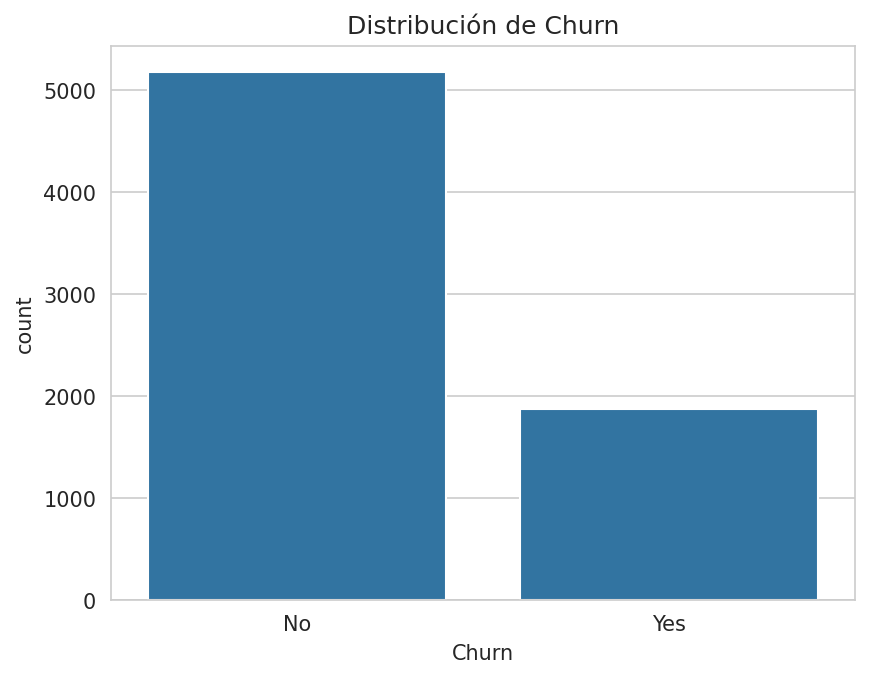
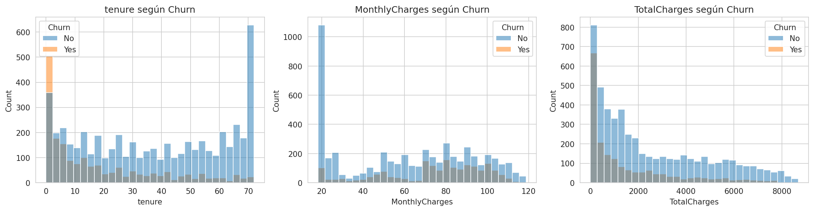
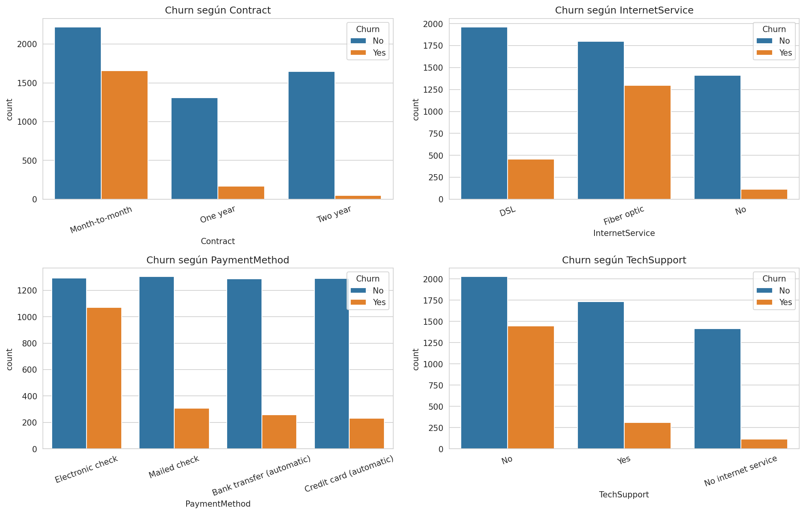
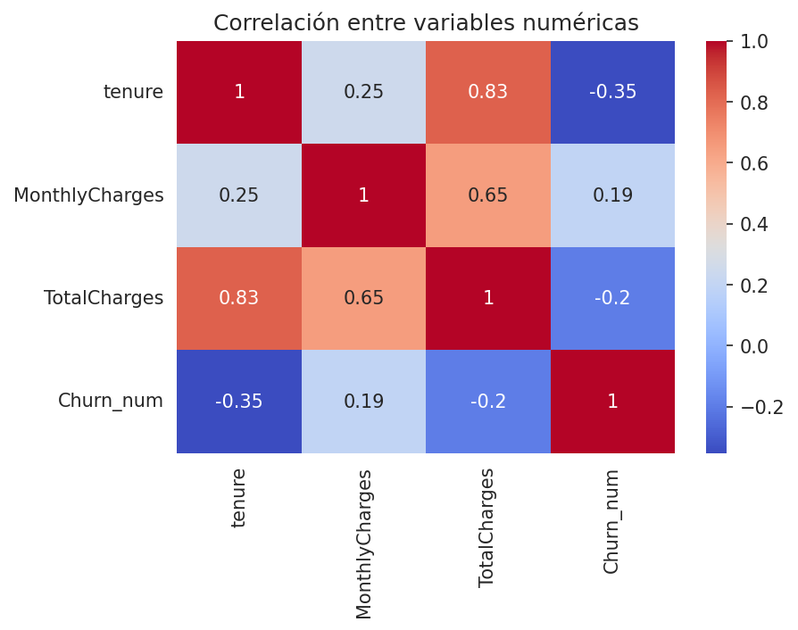
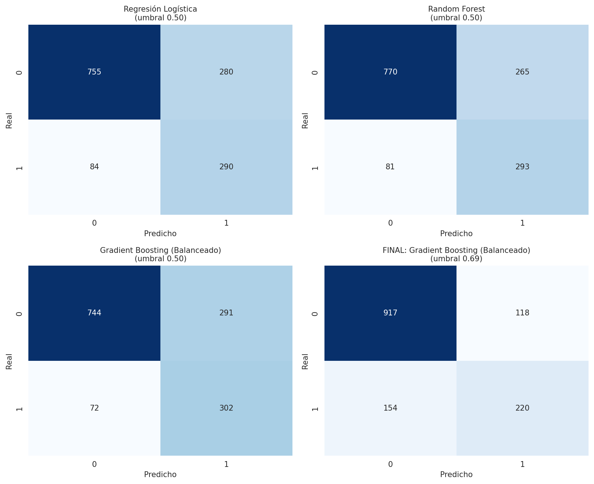
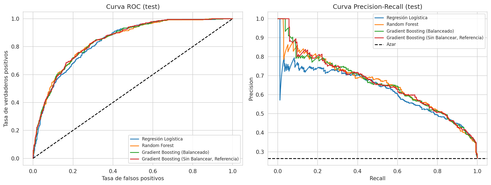
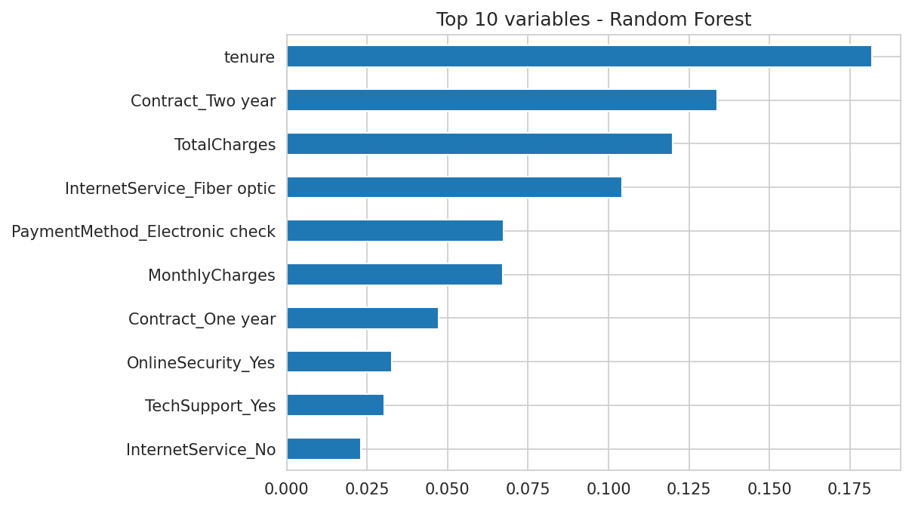
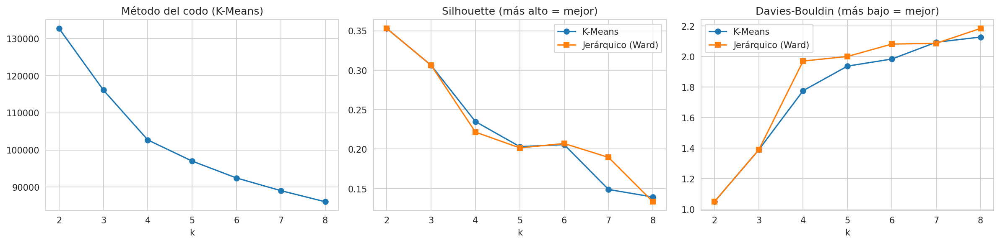
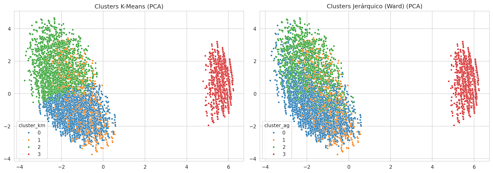

# Predicción de abandono de clientes (Telco Customer Churn)

**Asignatura:** Machine Learning (MLY1101) · **Evaluación Parcial N°2** · **Caso A**
**Integrantes:** Kimberly Bobadilla, Luna Cortés y Millaray Paillafil

---

## Resumen ejecutivo

Una empresa de telecomunicaciones pierde ingresos cada vez que un cliente se va (*churn*). En este proyecto usamos el dataset **Telco Customer Churn (IBM)**, con 7.043 clientes, para:

1. entender qué características tienen los clientes que abandonan,
2. construir y comparar **3 modelos supervisados de clasificación** (Regresión Logística, Random Forest y Gradient Boosting),
3. **segmentar** a los clientes con modelos no supervisados (K-Means y agrupamiento jerárquico), y
4. traducir los resultados en recomendaciones para el negocio, revisando además el impacto ético del modelo.

Los tres modelos rindieron de forma muy parecida (ROC-AUC en validación cruzada entre 0,845 y 0,848). Seleccionamos **Gradient Boosting con balanceo de clases** por sus resultados de validación cruzada (ROC-AUC CV = 0,848; Average Precision CV = 0,663; ROC-AUC en test reportado = 0,845). Con el umbral estándar de 0,50, el notebook reporta que detecta **302 de los 374 clientes que abandonaron** en el conjunto de prueba (Recall = 0,807), con 291 falsos positivos. La segmentación identificó **4 perfiles** de cliente, con tasas de churn reportadas entre 7,4 % y 47,3 %.

---

## Tabla de contenidos

1. [Descripción del problema de negocio](#1-descripción-del-problema-de-negocio)
2. [Objetivos del proyecto](#2-objetivos-del-proyecto)
3. [Metodología](#3-metodología)
4. [Descripción de las fuentes de datos](#4-descripción-de-las-fuentes-de-datos)
5. [Análisis exploratorio de los datos (EDA)](#5-análisis-exploratorio-de-los-datos-eda)
6. [Preparación y transformación de los datos](#6-preparación-y-transformación-de-los-datos)
7. [Justificación de la selección de modelos](#7-justificación-de-la-selección-de-modelos)
8. [Variables finales incluidas por modelo](#8-variables-finales-incluidas-por-modelo)
9. [Implementación de los modelos supervisados](#9-implementación-de-los-modelos-supervisados)
10. [Evaluación y selección del modelo](#10-evaluación-y-selección-del-modelo)
11. [Variables más importantes](#11-variables-más-importantes)
12. [Revisión ética y de sesgos](#12-revisión-ética-y-de-sesgos)
13. [Aprendizaje no supervisado: segmentación de clientes](#13-aprendizaje-no-supervisado-segmentación-de-clientes)
14. [Recomendaciones de negocio](#14-recomendaciones-de-negocio)
15. [Limitaciones y trabajo futuro](#15-limitaciones-y-trabajo-futuro)
16. [Instrucciones de ejecución](#16-instrucciones-de-ejecución)\n17. [Conclusiones](#17-conclusiones)

---

## 1. Descripción del problema de negocio

Una empresa de telecomunicaciones pierde ingresos cuando un cliente cancela el servicio. Retener a un cliente cuesta menos que conseguir uno nuevo, por lo que conviene **anticiparse** e identificar quiénes tienen más probabilidad de irse para enfocar en ellos las ofertas de retención.

El problema se plantea como una **clasificación binaria**: `0` = el cliente se queda y `1` = el cliente abandona. Además de predecir, queremos **agrupar** a los clientes en segmentos con características parecidas, porque no todos se van por las mismas razones y una sola campaña para toda la cartera sería poco eficiente.

El modelo no busca reemplazar una decisión humana, sino **apoyar la priorización** de a quién contactar.

## 2. Objetivos del proyecto

**Objetivo general:** desarrollar y evaluar modelos de Machine Learning que identifiquen clientes con riesgo de abandono y los segmenten según sus características, para apoyar decisiones de retención.

**Objetivos específicos:**

1. Analizar qué características tienen los clientes que abandonan (EDA) y revisar la calidad de los datos.
2. Preparar los datos para el modelamiento (codificación, división train/test, balanceo de clases).
3. Construir y comparar 3 modelos supervisados de clasificación con validación cruzada y ajuste de hiperparámetros.
4. Agrupar a los clientes con un modelo no supervisado (K-Means), comparándolo con agrupamiento jerárquico.
5. Evaluar con métricas adecuadas a un problema desbalanceado e interpretarlas para el negocio.
6. Revisar el impacto ético del modelo (sesgo por género y por adultos mayores).
7. Entregar recomendaciones de negocio.

## 3. Metodología

Seguimos una adaptación de **CRISP-DM**. La siguiente tabla muestra en qué parte de este informe y del notebook se desarrolla cada etapa:

| Etapa CRISP-DM | Qué hicimos | Sección del informe |
|---|---|---|
| Comprensión del negocio | Definimos el problema de churn, los objetivos y el tipo de modelos | 1, 2 |
| Comprensión de los datos | Calidad de datos, distribución de `Churn`, EDA numérico y categórico, correlaciones | 4, 5 |
| Preparación de los datos | Codificación *one-hot*, exclusión de `gender`, división estratificada 80/20, manejo del desbalance | 6 |
| Modelado | 3 modelos supervisados con `GridSearchCV` y 2 algoritmos de clustering | 7, 8, 9, 13 |
| Evaluación | Validación cruzada, evaluación en test, curvas ROC y PR, auditoría ética, estabilidad del clustering | 10, 11, 12, 13 |
| Despliegue / uso | Recomendaciones de negocio, limitaciones y guardado de modelos durante la ejecución del notebook | 14, 15 |

**Herramientas:** Python en Google Colab con Pandas, NumPy, Matplotlib, Seaborn, Scikit-learn y Joblib. Usamos `random_state = 42` en todo el proyecto para que los resultados sean reproducibles.

## 4. Descripción de las fuentes de datos

**Fuente:** *Telco Customer Churn* (IBM). Usamos una **versión limpia** del dataset, que preparamos en la evaluación anterior y que está guardada en `data/Telco_Customer_Churn_Clean.csv`.

- **Tamaño:** 7.043 clientes y 20 variables.
- **Identificador:** el dataset no incluye `customerID`.
- **Variable objetivo:** `Churn` (`Yes` / `No`).

| Grupo | Variables |
|---|---|
| Demográficas | `gender`, `SeniorCitizen`, `Partner`, `Dependents` |
| Servicios contratados | `PhoneService`, `MultipleLines`, `InternetService`, `OnlineSecurity`, `OnlineBackup`, `DeviceProtection`, `TechSupport`, `StreamingTV`, `StreamingMovies` |
| Contrato y pago | `Contract`, `PaperlessBilling`, `PaymentMethod` |
| Numéricas | `tenure` (meses de antigüedad), `MonthlyCharges`, `TotalCharges` |
| Objetivo | `Churn` |

## 5. Análisis exploratorio de los datos (EDA)

### 5.1 Calidad de los datos

Revisamos el tamaño, los tipos de datos, los nulos, los duplicados y los estadísticos descriptivos.

- **Nulos:** en la versión limpia `TotalCharges` ya está en formato numérico y los faltantes fueron tratados en la evaluación anterior.
- **Duplicados:** se detectaron **22 filas con todos sus valores coincidentes (aproximadamente 0,3 %)**. Según la revisión y el proceso de limpieza realizado en la evaluación anterior, estos registros corresponden a clientes diferentes y se conservaron en el dataset. Aunque esta versión no incluye la columna `customerID`, la decisión se basa en la revisión previa de los datos; se recomienda mantener el respaldo de ese proceso para justificar el criterio si se solicita.
- **`TotalCharges = 0`:** corresponde a **11 clientes con `tenure = 0`** (clientes nuevos que aún no reciben su primera factura). Los mantuvimos porque son registros válidos.

### 5.2 Variable objetivo

| Churn | Clientes | Porcentaje |
|---|---|---|
| No | 5.174 | 73,5 % |
| Sí | 1.869 | 26,5 % |

Las clases están **moderadamente desbalanceadas**. Por eso `Accuracy` no basta para evaluar los modelos (un modelo que dijera siempre "no se va" tendría ~73,5 % de accuracy sin detectar a nadie), y complementamos con Precision, Recall, F1, ROC-AUC y Average Precision.

### 5.3 Variables numéricas

| Grupo | Tenure promedio (meses) | MonthlyCharges promedio | TotalCharges promedio |
|---|---|---|---|
| Se quedan | 37,6 | 61,3 | 2.550 |
| Abandonan | 18,0 | 74,4 | 1.532 |

Los clientes que abandonan tienen **menos antigüedad y pagan más al mes**. Su `TotalCharges` es menor simplemente porque llevan menos tiempo contratados. Los clientes antiguos casi no se van.

### 5.4 Variables categóricas

| Variable | Tasa de churn |
|---|---|
| **Contrato** | Mes a mes: 42,7 % · 1 año: 11,3 % · 2 años: 2,8 % |
| **Internet** | Fibra óptica: 41,9 % · DSL: 19,0 % · Sin internet: 7,4 % |
| **Método de pago** | Cheque electrónico: 45,3 % · otros métodos: entre 15,2 % y 19,1 % |
| **Soporte técnico** | Sin soporte: 41,6 % · con soporte: 15,2 % |
| **Adulto mayor** | Sí: 41,7 % · No: 23,6 % |
| **Género** | Mujeres: 26,9 % · Hombres: 26,2 % (sin diferencia relevante) |

### 5.5 Correlaciones

- `tenure` tiene una correlación negativa moderada con el churn (**−0,35**): los clientes nuevos son más propensos a irse.
- `MonthlyCharges` tiene una relación positiva leve con el churn (**0,19**).
- `TotalCharges` y `tenure` están muy correlacionadas (**0,83**). Esta multicolinealidad puede distorsionar a los modelos lineales, así que más adelante excluimos `TotalCharges` de la Regresión Logística.

> Estos resultados muestran **asociaciones**, no causalidad.

## 6. Preparación y transformación de los datos

1. **Variable objetivo:** `Churn` se transformó a binario (`No` = 0, `Yes` = 1).
2. **Exclusión de `gender`:** la sacamos de los predictores por criterio ético, pero la conservamos aparte para la auditoría de sesgo (sección 12).
3. **Codificación:** las variables categóricas se convirtieron con *One-Hot Encoding* (`pd.get_dummies(..., drop_first=True)`). El resultado son **29 variables predictoras**.
4. **División train/test:** 80 % entrenamiento (5.634 clientes) y 20 % prueba (1.409 clientes), con `stratify=y` para mantener la misma proporción de churn (26,5 %) en ambos conjuntos.
5. **Escalado:** `StandardScaler` solo para la Regresión Logística (dentro de un *pipeline*, para no filtrar información del test). Random Forest y Gradient Boosting no lo necesitan.
6. **Desbalance de clases:** `class_weight='balanced'` en Regresión Logística y Random Forest, y `sample_weight` balanceado en Gradient Boosting (que no tiene `class_weight`).
7. **Validación:** los tres modelos usan los mismos **5 folds estratificados** (`StratifiedKFold`, `shuffle=True`, `random_state=42`).

## 7. Justificación de la selección de modelos

Elegimos tres clasificadores que representan enfoques distintos, para comparar un modelo lineal con modelos basados en árboles:

| Modelo | Por qué lo elegimos |
|---|---|
| **Regresión Logística** | Línea base simple e interpretable. Sus coeficientes permiten explicar en qué dirección influye cada variable. |
| **Random Forest** | Captura relaciones no lineales e interacciones entre variables, es robusto al ruido y entrega una importancia de variables (orientativa). |
| **Gradient Boosting** | Suele tener muy buen rendimiento en datos tabulares porque corrige errores de forma secuencial con árboles pequeños. |

Como referencia, entrenamos además un **Gradient Boosting sin balancear**, solo para mostrar el efecto del balanceo de clases.

## 8. Variables finales incluidas por modelo

| Modelo | N° de variables | Variable excluida | Escalado | Tratamiento del desbalance |
|---|---|---|---|---|
| Regresión Logística | 28 | `TotalCharges` (colinealidad con `tenure`, 0,83) | `StandardScaler` (en pipeline) | `class_weight='balanced'` |
| Random Forest | 29 | ninguna | no necesita | `class_weight='balanced'` |
| Gradient Boosting | 29 | ninguna | no necesita | `sample_weight` balanceado |

Las 29 variables corresponden a las numéricas (`SeniorCitizen`, `tenure`, `MonthlyCharges`, `TotalCharges`) y a las variables categóricas codificadas (por ejemplo `Contract_One year`, `Contract_Two year`, `InternetService_Fiber optic`, `InternetService_No`, `PaymentMethod_Electronic check`, `OnlineSecurity_Yes`, `TechSupport_Yes`, etc.). El listado completo se imprime en el notebook (sección *Variables Finales por Modelo*).

## 9. Implementación de los modelos supervisados

Los hiperparámetros se ajustaron con `GridSearchCV` usando los 5 folds estratificados y **ROC-AUC** como métrica, de modo que la elección no depende de una sola división de los datos.

| Modelo | Malla de búsqueda | Mejores hiperparámetros | AUC (GridSearchCV) |
|---|---|---|---|
| Regresión Logística | `C` ∈ {0,01; 0,1; 1; 10} | `C = 10` | 0,845 |
| Random Forest | `n_estimators` ∈ {100, 200}; `max_depth` ∈ {5, 8, 12}; `min_samples_leaf` ∈ {1, 5, 10} | `n_estimators=200`, `max_depth=8`, `min_samples_leaf=10` | 0,848 |
| Gradient Boosting | `n_estimators` ∈ {100, 200}; `learning_rate` ∈ {0,05; 0,1}; `max_depth` ∈ {2, 3} | `n_estimators=200`, `learning_rate=0,05`, `max_depth=2` | 0,849 |

El notebook guarda los tres modelos con `joblib` en la carpeta `models/` durante la ejecución: `regresion_logistica.pkl`, `random_forest.pkl` y `gradient_boosting.pkl`. Para que otra persona pueda reutilizarlos sin volver a entrenar, esos archivos deben incluirse explícitamente en la entrega; si no se entregan, pueden generarse ejecutando el notebook.

## 10. Evaluación y selección del modelo

### 10.1 Selección en validación cruzada

Para comparar los tres modelos bajo el mismo esquema, generamos **predicciones fuera de fold** (`cross_val_predict`) sobre el conjunto de entrenamiento. Así evitamos mirar el test para decidir.

| Modelo | ROC-AUC (CV) | Average Precision (CV) |
|---|---|---|
| Regresión Logística | 0,845 | 0,655 |
| Random Forest | 0,847 | 0,661 |
| **Gradient Boosting (balanceado)** | **0,848** | **0,663** |

Las diferencias están dentro del ruido de la validación cruzada. Aun así, **seleccionamos Gradient Boosting balanceado** por tener el mayor ROC-AUC y Average Precision en CV. Este criterio se definió **antes de mirar el test**.

### 10.2 Evaluación final en el conjunto de prueba (umbral 0,50)

| Modelo | Accuracy | Precision | Recall | F1 | ROC-AUC |
|---|---|---|---|---|---|
| Regresión Logística | 0,742 | 0,509 | 0,775 | 0,614 | 0,838 |
| Random Forest | 0,754 | 0,525 | 0,783 | 0,629 | 0,845 |
| **Gradient Boosting (balanceado)** | 0,742 | 0,509 | **0,807** | 0,625 | 0,845 |
| Gradient Boosting sin balancear (referencia) | 0,798 | 0,656 | 0,500 | 0,568 | 0,846 |

### 10.3 Interpretación de las métricas

- **ROC-AUC ≈ 0,845:** si tomamos un cliente que se fue y uno que se quedó al azar, el modelo le asigna mayor probabilidad de churn al que se fue en cerca del 84,5 % de los casos. Las curvas ROC de los tres modelos son casi idénticas, coherente con el empate en AUC.
- **Average Precision (CV) = 0,663:** la proporción base de churn es 26,5 %, así que el modelo rinde unas 2,5 veces mejor que elegir al azar. En la curva Precision-Recall, Gradient Boosting y Random Forest mantienen una precisión algo mayor que la Regresión Logística en recall bajo y medio (entre 0,0 y 0,6).
- **Matriz de confusión de Gradient Boosting (umbral 0,50):** detecta **302 de 374** clientes que realmente se van (Recall = 0,807), deja pasar 72 y genera **291 falsos positivos**. Esto significa que, de los ~593 clientes marcados en riesgo, aproximadamente la mitad (Precision = 0,509) se iba a ir de verdad.
- **Efecto del balanceo:** sin balancear, el modelo tiene más accuracy (0,798) pero **solo detecta al 50 % de quienes se van** (Recall = 0,500). Para un problema de retención, perder la mitad de los clientes en fuga es un costo alto, por eso preferimos la versión balanceada.
- **Accuracy y F1 de Random Forest:** a umbral 0,50 Random Forest es levemente superior (0,754 y 0,629 contra 0,742 y 0,625). Mantenemos Gradient Boosting por el criterio definido de antemano en CV y porque tiene el mayor Recall, que es lo más importante para no dejar escapar clientes. Reconocemos que **las diferencias entre los tres modelos son pequeñas**.

### 10.4 Umbral de decisión

Usamos el umbral estándar de **0,50** para comparar los modelos en igualdad de condiciones y lo mantuvimos como umbral operativo. Subirlo reduciría las falsas alarmas (más Precision) a costa de dejar escapar más clientes (menos Recall). La elección ideal depende del costo real de una oferta de retención frente al ingreso perdido por un cliente, información que no tenemos. Dejamos esta calibración como trabajo futuro (sección 15).

## 11. Variables más importantes

Random Forest (importancia basada en impureza, solo orientativa) destaca estas variables:

| Variable | Importancia |
|---|---|
| `tenure` | 0,182 |
| `Contract_Two year` | 0,134 |
| `TotalCharges` | 0,120 |
| `InternetService_Fiber optic` | 0,104 |
| `PaymentMethod_Electronic check` | 0,067 |
| `MonthlyCharges` | 0,067 |
| `Contract_One year` | 0,047 |
| `OnlineSecurity_Yes` | 0,033 |
| `TechSupport_Yes` | 0,030 |
| `InternetService_No` | 0,023 |

En la Regresión Logística (variables estandarizadas) los coeficientes confirman la dirección de las relaciones: la **antigüedad (−0,76)** y los **contratos de uno (−0,30) y dos años (−0,62)** reducen el riesgo de churn, mientras que la **fibra óptica (+1,29)** lo aumenta.

Ambos modelos coinciden con el EDA: el riesgo se concentra en clientes nuevos, con contrato mes a mes y fibra óptica. Son relaciones **predictivas**, no necesariamente causales.

## 12. Revisión ética y de sesgos

### 12.1 Decisiones tomadas

- La variable `gender` se excluyó de los predictores del modelo por criterio ético y se conservó para auditar diferencias de desempeño entre grupos.
- `SeniorCitizen` se mantuvo como predictor por su relación observada con el abandono en el EDA. También se utiliza para revisar posibles diferencias de desempeño entre adultos mayores y el resto de los clientes.
- La auditoría se realiza sobre el conjunto de prueba, usando el modelo **Gradient Boosting (balanceado)** y el umbral de clasificación de **0,50**.

### 12.2 Métricas auditadas

El notebook calcula por grupo el tamaño de la muestra, el porcentaje de churn real, el porcentaje marcado en riesgo, Recall, Precision y la tasa de falsos positivos. Los valores finales de esta sección deben transcribirse desde la tabla que imprime la celda de auditoría ética después de ejecutar el notebook completo en Colab.

| Grupo auditado | Métricas a reportar |
|---|---|
| `gender` | tamaño del grupo, churn real, porcentaje marcado en riesgo, Recall, Precision y falsos positivos (%) |
| `SeniorCitizen` | tamaño del grupo, churn real, porcentaje marcado en riesgo, Recall, Precision y falsos positivos (%) |

**Importante:** las cifras narradas en distintas versiones del informe no deben combinarse si no coinciden con la tabla generada por el código. Antes de entregar, reemplazar esta tabla descriptiva por los resultados reales de Colab, o insertar la tabla de salida directamente. No se afirma aquí que excluir `gender` no tenga impacto en el rendimiento, porque esa conclusión requeriría comparar experimentalmente modelos entrenados con y sin dicha variable.

### 12.3 Interpretación responsable

La tasa de falsos positivos se calcula como `FP / (FP + TN)`: representa la proporción de clientes que realmente no abandonaron, pero fueron clasificados como posibles casos de abandono. Debe distinguirse de la proporción de clientes que el modelo marcó en riesgo (`pred.mean()`).

Las diferencias entre grupos deben interpretarse considerando tanto el desempeño del modelo como la tasa real de abandono de cada grupo. Una disparidad es una señal que merece revisión, pero por sí sola no demuestra discriminación causal. La exclusión de una variable sensible tampoco garantiza que el modelo esté libre de sesgos, ya que otras variables pueden estar relacionadas con ella.

### 12.4 Medidas de mitigación y privacidad

Antes de un uso real, se recomienda:
- comparar modelos con y sin `gender` para cuantificar el efecto de esa decisión sobre las métricas;
- analizar las diferencias de Recall, Precision y tasa de falsos positivos entre grupos;
- evaluar medidas de mitigación apropiadas y documentar sus efectos;
- mantener revisión humana antes de activar campañas comerciales;
- usar únicamente los datos necesarios, limitar los accesos y monitorear el desempeño con datos nuevos.

El modelo debe apoyar la priorización de acciones de retención; no debe utilizarse para negar servicios ni aplicar sanciones a los clientes.

## 13. Aprendizaje no supervisado: segmentación de clientes

**Objetivo:** encontrar grupos de clientes con características parecidas para diseñar acciones distintas según el perfil. Es un complemento a la predicción: el modelo supervisado dice *quién* tiene riesgo y la segmentación ayuda a entender *qué tipo de cliente* es.

**Datos y algoritmos:** usamos las 28 variables de la Regresión Logística, escaladas con `StandardScaler`, y comparamos **K-Means** con **agrupamiento jerárquico aglomerativo (enlace Ward)**. La variable `Churn` **no** se usó para construir los clusters, solo para describirlos después.

### 13.1 Elección de k

Probamos k entre 2 y 8 con inercia (método del codo), Silhouette y Davies-Bouldin.

- **k = 2** tiene el mejor Silhouette (0,353) y Davies-Bouldin (1,048), pero su partición es poco útil: solo separa a los clientes **sin internet** (1.526 clientes, 7,4 % de churn) de un único grupo de 5.517 clientes (78 %) con 31,8 % de churn que mezcla perfiles muy distintos. Dentro de ese grupo grande, el churn de los segmentos de k = 4 va de 14,9 % a 47,3 %, así que una sola estrategia no sería adecuada.
- **k = 4** fue nuestra elección: en el codo muestra el último descenso relevante de inercia (**11,55 %**) y divide al grupo grande en perfiles con riesgo, antigüedad y facturación claramente distintos.
- **Reconocemos una limitación:** el Silhouette con k = 4 es 0,235 en K-Means y 0,222 en el jerárquico, lo que indica una estructura **moderada a débil**. La decisión se apoya en la utilidad comercial y no solo en las métricas.

### 13.2 Estabilidad de los clusters

| Verificación | Resultado | Interpretación |
|---|---|---|
| ARI de K-Means entre 10 semillas | promedio 0,999 | K-Means es muy estable |
| ARI K-Means vs. jerárquico | 0,664 | Concordancia moderada: los segmentos tienen cierto respaldo, aunque no son idénticos |
| Silhouette K-Means / jerárquico | 0,235 / 0,222 | Grupos con solapamiento |

Para visualizar usamos **PCA de 2 componentes**, que explican solo el **45,5 %** de la varianza. Por eso el solapamiento del gráfico es esperable; el PCA se usó únicamente para graficar, no para segmentar.

### 13.3 Perfil de los segmentos (K-Means, k = 4)

Después de entrenar el clustering, se reordenan las etiquetas de los grupos de mayor a menor tasa de churn para facilitar su interpretación. El churn no se incorpora a las variables usadas para ajustar K-Means ni el modelo jerárquico; se utiliza después para describir y ordenar los perfiles.

| Cluster | Clientes | Tenure prom. | Cargo mensual | Churn | Perfil principal |
|---|---|---|---|---|---|
| **C0** | 2.670 | 16,2 | 74,2 | **47,3 %** | Clientes nuevos, 92,7 % con contrato mes a mes, mucha fibra óptica y pocos servicios adicionales (1,5 en promedio) |
| **C1** | 682 | 31,7 | 42,0 | 24,9 % | Clientes con DSL, cargos mensuales intermedios y riesgo moderado |
| **C2** | 2.165 | 53,8 | 91,1 | 14,9 % | Clientes antiguos, de alta facturación y con varios servicios agregados |
| **C3** | 1.526 | 30,5 | 21,1 | **7,4 %** | Clientes sin internet, bajo costo mensual y el riesgo más bajo |

**Lectura de negocio:** C0 es el segmento prioritario para retención. C2 es un segmento de **alto valor** (antiguo y de alta facturación) con riesgo bajo, que conviene cuidar. C3 casi no abandona.

## 14. Recomendaciones de negocio

| Segmento | Recomendación |
|---|---|
| **C0 – Alto riesgo (47,3 %)** | Priorizar campañas de retención. Incentivar el paso de contrato mes a mes a contratos de 1 o 2 años (que tienen 11,3 % y 2,8 % de churn) y revisar la experiencia de los clientes con fibra óptica (41,9 % de churn). Ofrecer soporte técnico, ya que sin él el churn es 41,6 %. |
| **C1 – Riesgo moderado (24,9 %)** | Campañas de fidelización moderadas y evaluar servicios adicionales que aumenten la permanencia. |
| **C2 – Alto valor, bajo riesgo (14,9 %)** | Evitar descuentos masivos innecesarios; usar beneficios de fidelización para mantener la relación. |
| **C3 – Bajo riesgo (7,4 %)** | Monitoreo de bajo costo y evitar campañas agresivas. |

**Uso del modelo predictivo:**

- Usar el *score* de Gradient Boosting para ordenar a los clientes por riesgo y contactar primero a los de mayor probabilidad, combinándolo con el segmento al que pertenecen.
- Con el umbral 0,50 la campaña alcanzaría a ~81 % de quienes se van, pero la mitad de los contactados no se iría. Si el costo de la oferta es alto, conviene **subir el umbral** para contactar a menos clientes con mayor certeza.
- Mantener **revisión humana** antes de aplicar acciones comerciales, sobre todo en adultos mayores (ver sección 12).

## 15. Limitaciones y trabajo futuro

**Limitaciones**

- El dataset es histórico y puede no representar a los clientes actuales de una empresa real.
- Los resultados muestran asociaciones predictivas, no relaciones causales.
- Las diferencias entre los tres modelos son pequeñas; la elección de Gradient Boosting se apoya en diferencias mínimas de CV.
- El clustering tiene un Silhouette de 0,235 (estructura moderada a débil) y K-Means usa distancia euclidiana sobre variables *dummy*, que no representa perfectamente variables categóricas.
- Existe una disparidad de falsos positivos en adultos mayores.
- El umbral de 0,50 no se optimizó con costos reales del negocio.
- Las recomendaciones comerciales se derivan de patrones observados y predicciones; no se ha demostrado mediante una prueba experimental que las campañas propuestas reduzcan efectivamente el abandono.

**Trabajo futuro**

- Calibrar el umbral de decisión con costos, márgenes y tasas de aceptación reales de la empresa.
- Probar mitigaciones de sesgo: excluir `SeniorCitizen`, umbrales por grupo o revisión humana.
- Validar el modelo con datos nuevos y monitorear cambios en el comportamiento de los clientes.
- Comparar otras técnicas de segmentación pensadas para variables mixtas (por ejemplo K-Prototypes).

## 16. Instrucciones de ejecución

### Requisitos

- Python y un entorno compatible con las bibliotecas utilizadas.
- Google Colab o Jupyter Notebook.
- El archivo `Telco_Customer_Churn_Clean.csv`.
- Las bibliotecas Pandas, NumPy, Matplotlib, Seaborn, Scikit-learn y Joblib.

### Pasos para ejecutar el proyecto

1. Abrir el notebook del proyecto en Google Colab o Jupyter.
2. Ubicar el archivo `Telco_Customer_Churn_Clean.csv` en la carpeta de datos correspondiente.
3. Verificar que la ruta de `pd.read_csv()` coincida con la ubicación real del archivo. En la versión actual del notebook se utiliza `/content/data/Telco_Customer_Churn_Clean.csv`.
4. Ejecutar las celdas en orden y comprobar que no existan errores.
5. Revisar las métricas de clasificación, las tablas de auditoría ética y los perfiles de clustering que se generan.
6. Confirmar que las imágenes se guarden en `images/` y los modelos en `models/`.

Las carpetas `images/` y `models/` se crean durante la ejecución. Los archivos `.pkl` se generan al ejecutar el notebook y deben incluirse en la entrega si se requiere reutilizar los modelos sin volver a entrenarlos.

**Verificación antes de entregar:** en la versión actual del notebook, la llamada `print(perfil('cluster_k2').to_string())` aparece antes de la definición de la función `perfil()`. Debe moverse después de la definición de la función para que el notebook pueda ejecutarse de principio a fin en orden. También se deben actualizar las cifras de la auditoría ética con los resultados impresos por la ejecución final.

## 17. Conclusiones

1. **Diagnóstico:** la antigüedad y el tipo de contrato son los factores que más separan a quien se queda de quien se va. El riesgo se concentra en contratos mes a mes, fibra óptica y pago con cheque electrónico.
2. **Modelo:** los tres modelos rinden de forma muy similar. Seleccionamos **Gradient Boosting balanceado** (ROC-AUC CV 0,848, Average Precision CV 0,663, ROC-AUC test 0,845). Con umbral 0,50 detecta el **80,7 %** de los clientes que abandonan; el balanceo de clases fue clave, ya que sin él el Recall cae a 50 %.
3. **Segmentación:** identificamos 4 perfiles con riesgos entre 7,4 % y 47,3 %. Esto permite diferenciar las acciones de retención en lugar de aplicar una sola campaña. La estructura de los clusters es moderada, por lo que los usamos como guía comercial y no como fronteras exactas.
4. **Ética:** se excluyó `gender` de los predictores y se revisaron diferencias de desempeño por género y condición de adulto mayor. Las cifras definitivas deben corresponder a la tabla producida por la auditoría en Colab. Antes de un uso real se recomienda comparar modelos con y sin variables sensibles, analizar posibles disparidades y mantener revisión humana.
5. **Cierre:** el modelo es una **herramienta de apoyo**. Antes de usarlo en una empresa real habría que validarlo con datos actuales, calibrar el umbral con costos reales, comprobar que las cifras de la auditoría ética coincidan con la salida del notebook y monitorear posibles disparidades.
